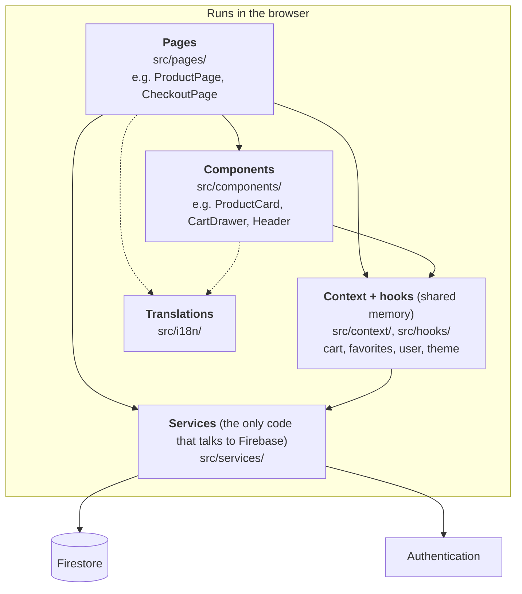
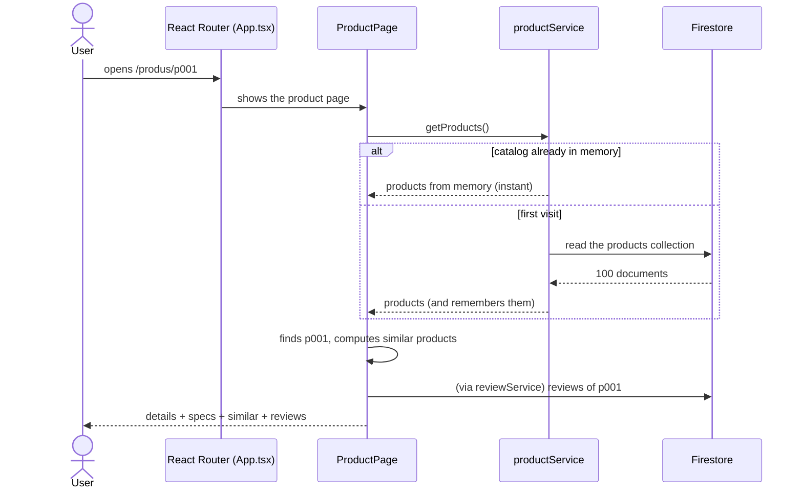

# 03 – Architecture

## The main idea: layers

The app is split into **layers**, each with a single job. Each layer only talks to the one below it.



| Layer | What it does | Comparison |
|---|---|---|
| **Pages** | what is shown at each address; they assemble components | the rooms of a house |
| **Components** | reusable pieces of interface | furniture – the same sofa can be in several rooms |
| **Context / hooks** | data used by several pages (cart, signed-in user, theme) | a shared noticeboard in the house |
| **Services** | the only place that reads/writes Firebase | the courier – only they leave the house to fetch parcels |
| **Translations** | all texts, in Romanian and English | the house dictionary |

**Why it matters:** the first version of the app read products from a JSON file. Moving to Firebase meant rewriting **only the services** – the pages stayed almost the same. If the database ever changes again, only `src/services/` changes.

## Folder structure

```
ecommerce-website/
├── docs/                    ← this documentation
├── e2e/                     ← Playwright automated tests
├── public/                  ← files served as-is (icon, fallback SVG illustrations)
├── scripts/                 ← admin programs (catalog import, demo data, images)
│   └── data/db.json         ← seed data: categories, 100 products, 390 reviews
├── src/                     ← THE APPLICATION CODE
│   ├── main.tsx             ← entry point
│   ├── App.tsx              ← list of pages (routes) + shared memory providers
│   ├── index.css            ← global styles + light/dark theme colours
│   ├── lib/firebase.ts      ← Firebase connection
│   ├── pages/               ← one file per page
│   ├── components/          ← interface pieces
│   │   └── admin/           ← admin panel pieces (charts, tabs)
│   ├── context/             ← cart, favorites, account, theme
│   ├── hooks/               ← loading products and categories
│   ├── services/            ← talking to Firebase
│   ├── types/               ← data “shapes” (fields of a product, an order…)
│   ├── i18n/                ← translations (ro.ts, en.ts)
│   ├── data/romania.ts      ← list of Romanian counties
│   └── utils/               ← small helpers: price/date formatting, search, images
├── .env                     ← Firebase project addresses
├── firestore.rules          ← database security rules
├── firebase.json            ← publishing settings (Hosting)
├── playwright.config.ts     ← test settings
└── package.json             ← list of libraries and commands (npm run …)
```

## Pages (routes)

| Address | File | Shows | Access |
|---|---|---|---|
| `/` | `ProductsPage.tsx` | all products | anyone |
| `/categorie/:id` | `ProductsPage.tsx` | products of one category | anyone |
| `/produs/:id` | `ProductPage.tsx` | details, specs, similar products, reviews | anyone |
| `/cautare?q=…` | `SearchPage.tsx` | search results | anyone |
| `/favorite` | `FavoritesPage.tsx` | favorite products | anyone |
| `/contact` | `ContactPage.tsx` | contact details + form | anyone |
| `/autentificare` | `LoginPage.tsx` | sign in | anyone |
| `/cont-nou` | `RegisterPage.tsx` | create account | anyone |
| `/finalizare-comanda` | `CheckoutPage.tsx` | delivery + payment + summary | anyone (with items in the cart) |
| `/comanda-finalizata` | `OrderSuccessPage.tsx` | order confirmation | right after an order |
| `/comenzile-mele` | `OrdersPage.tsx` | order history | signed-in user |
| `/admin` | `AdminPage.tsx` | statistics dashboard | admin |
| `/admin/comenzi` | `AdminOrdersPage.tsx` | all orders, with filters | admin |
| `/admin/comenzi/:id` | `AdminOrderDetailPage.tsx` | one order’s details + status change | admin |
| `/admin/clienti` | `AdminCustomersPage.tsx` | customer statistics + customer list | admin |
| `/admin/produse` | `AdminProductsPage.tsx` | product list + stock | admin |
| `/admin/produse/nou`, `/admin/produse/:id` | `AdminProductFormPage.tsx` | add / edit product | admin |

Restricted pages are wrapped in the `RequireAuth` component: if you are not signed in, it sends you to the sign-in page and brings you back afterwards.

## What happens when you open a product page



**Catalog cache:** the catalog is read **once per visit** and remembered. Firestore charges per document read, and navigation is faster. After an admin changes a product, the memory is cleared and the catalog is read again.

## Shared memory (context) – what is kept and where

| What | File | Stored in |
|---|---|---|
| Cart | `CartProvider.tsx` | the browser (`localStorage`) – survives a refresh |
| Favorites | `FavoritesProvider.tsx` | guest: the browser; signed-in user: Firestore (`users/{uid}.favoriteIds`) |
| Signed-in user + admin role | `AuthProvider.tsx` | the session is kept by Firebase Authentication |
| Theme (light/dark) | `ThemeProvider.tsx` | the browser |
| Language | `src/i18n/index.ts` | the browser |

## How an order flows (summary)

`Cart` → `Checkout (delivery + payment)` → `orderService.placeOrder()` writes to the `orders` collection → the cart is emptied → `Order confirmation`. Details in [Cart and checkout](features/cart-and-checkout.md).
