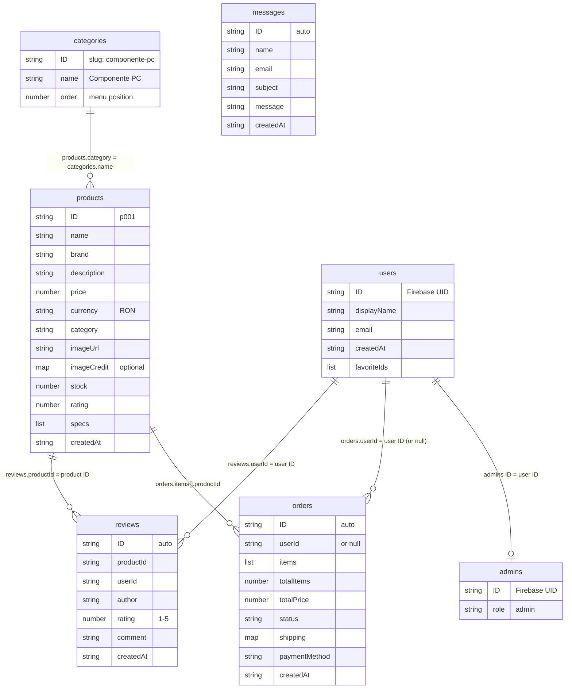

# 04 – Database (Cloud Firestore)

## How Firestore is organised

Firestore stores data in **collections** (folders) that contain **documents** (cards). Each document has an **ID** (the card’s name) and **fields** (its boxes). A field can be text, a number, true/false, a list or a nested object (“map”).

You can view and edit everything in **Firebase console → Firestore Database → Data**.

## All collections at a glance

| Collection | Contains | Count (after import) | Written by |
|---|---|---|---|
| `categories` | the 8 menu categories | 8 | admin / script |
| `products` | the products | 100 | admin (panel) / script |
| `reviews` | product reviews | 390 + those written by customers | signed-in customers |
| `orders` | orders | varies | anyone (new order), admin (status) |
| `messages` | contact form messages | varies | anyone |
| `users` | one profile per account | 1 per account | the account owner |
| `admins` | the list of administrators | manual | **Firebase console only** |

---

## `categories`

The document ID is a “slug” (short name without diacritics) also used in the page address: `/categorie/componente-pc`.

| Field | Type | Example | Meaning |
|---|---|---|---|
| `name` | text | `"Componente PC"` | displayed name (the English translation is in `src/i18n/locales/en.ts`) |
| `order` | number | `1` | position in the menu |

## `products`

ID: `p001` … `p100` (new products automatically get the next free number).

| Field | Type | Example | Meaning |
|---|---|---|---|
| `name` | text | `"Procesor AMD Ryzen 7 7800X3D"` | product name |
| `brand` | text | `"AMD"` | manufacturer |
| `description` | text | `"8 nuclee / 16 fire…"` | short description |
| `price` | number | `1899` | price in RON |
| `currency` | text | `"RON"` | currency |
| `category` | text | `"Componente PC"` | category name (must exist in `categories`) |
| `imageUrl` | text | `"https://upload.wikimedia.org/…"` | photo address |
| `imageCredit` | map (optional) | see below | photo author and licence |
| `stock` | whole number | `15` | units available; `0` = out of stock |
| `rating` | number | `4.9` | rating shown on the card |
| `specs` | list | `[{ name: "Socket", value: "AM5" }, …]` | technical specifications, in display order |
| `createdAt` | text (ISO date) | `"2026-10-01T10:00:00Z"` | date added |

`imageCredit` (for Creative Commons photos):

| Field | Example |
|---|---|
| `author` | `"FritzchensFritz"` |
| `license` | `"CC0"`, `"CC BY-SA 4.0"` |
| `licenseUrl` | link to the licence text (or `null`) |
| `sourceUrl` | the image page on Wikimedia Commons |
| `sourceName` | `"Wikimedia Commons"` |
| `representative` | `true` if the photo does not show the exact model (shows “Image for illustration purposes”) |

**Why is `specs` a list and not a map?** Firestore does not guarantee key order inside a map, and specifications must be shown in a specific order.

## `reviews`

| Field | Type | Example | Meaning |
|---|---|---|---|
| `productId` | text | `"p001"` | reviewed product |
| `userId` | text | UID | author (missing on imported seed reviews) |
| `author` | text | `"Andrei M."` | displayed name |
| `rating` | whole number | `5` | rating, 1–5 |
| `comment` | text | `"Produs excelent…"` | text (max 1000 characters) |
| `createdAt` | text (ISO date) | | date posted |

## `orders`

| Field | Type | Meaning |
|---|---|---|
| `userId` | text or `null` | customer account; `null` = guest order |
| `items` | list | ordered products – **snapshots** taken at checkout (see below) |
| `totalItems` | number | total number of units |
| `totalPrice` | number | total in RON |
| `status` | text | `placed`, `processing`, `shipped`, `delivered`, `cancelled` |
| `shipping` | map | delivery address (see below) |
| `paymentMethod` | text | `card` (online card, simulated), `card_on_delivery`, `cash_on_delivery`, `bank_transfer` |
| `createdAt` | text (ISO date) | order date |

An `items` entry: `productId`, `name`, `imageUrl`, `price`, `currency`, `quantity`.
**Why snapshots?** If a product’s price changes later, the order keeps the price that was paid.

`shipping`: `name`, `phone`, `email`, `county`, `city`, `address`.

> Orders created before the checkout step existed may lack `shipping` and `paymentMethod`; the app shows them without that information.

## `messages`

`name`, `email`, `subject`, `message`, `createdAt`. They can only be sent from the site; admins read them in the dashboard and the console.

## `users`

ID = the account’s **UID** from Firebase Authentication (a unique code, e.g. `O1TtNGppH8MhUeUMHKqslM5Im122`).

| Field | Meaning |
|---|---|
| `displayName` | displayed name |
| `email` | email address |
| `createdAt` | profile creation date |
| `favoriteIds` | IDs of favorite products, e.g. `["p001", "p043"]` |

> Passwords are **not** here – Firebase Authentication keeps them.

## `admins`

ID = the UID of the account that becomes an admin. The content does not matter (e.g. `role: "admin"`); only the **existence** of the document does. Created **only from the console** – see [How to make someone an administrator](07-how-to-change-things.md#make-someone-an-administrator).

---

## Where is the initial data?

In `scripts/data/db.json` (categories, products, reviews). The `npm run seed` script copies it into Firestore. Editing the file does **not** change the database by itself – run the script (or edit the product in the admin panel). See [09 – Operations](09-operations-and-deployment.md).

## Indexes

The app only uses simple queries (one filter each), so it **needs no composite indexes**. For example, reviews are filtered by `productId` in Firestore and sorted by date in the browser.
