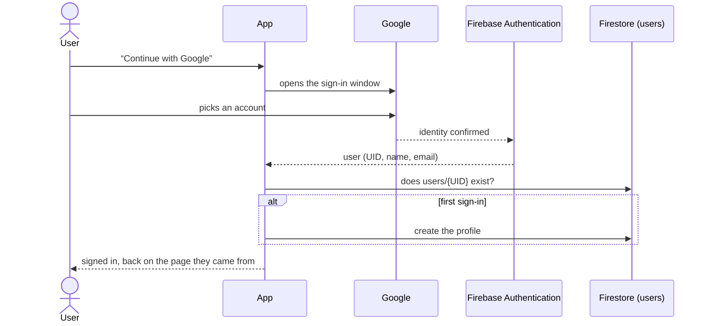

# 05 – Authentication and roles

## Sign-in methods

### 1. Email and password
- On **Create account** (*Creează cont*, `/cont-nou`) the user enters **name, email, password** (at least 6 characters) and confirms the password.
- Firebase Authentication creates the account and stores the password securely. The app never sees or stores passwords.
- Later sign-ins: **Sign in** page (*Intră în cont*, `/autentificare`).

### 2. Google (“Continue with Google”)
- The user clicks the button; a Google window opens where they pick their account.
- Google confirms the identity to Firebase; the app receives the name and email (never the Google password).
- On the first sign-in, the profile in `users` is created automatically.

> **Note:** a Google account and an email+password account on the **same address** can be **two different accounts**, with different UIDs.

## Session

Firebase keeps the session in the browser: the user stays signed in after a refresh or closing the tab, until they click **Sign out** (the avatar menu, top-right).

## Roles

| Role | How you get it | What it unlocks |
|---|---|---|
| Visitor | default | catalog, cart, orders, contact |
| Customer | sign in | favorites in the account, order history, reviews |
| Administrator | an `admins/{UID}` document in Firestore | admin panel (`/admin`), product/stock management, order status |

**Why is admin a separate collection instead of a field in the profile?** Every user can edit their own profile (`users/{uid}`). If the role lived there, anyone could make themselves an admin. Nobody can write to `admins` from the app – only from the Firebase console.

**The check happens twice:**
1. in the app (`AuthProvider` reads `admins/{uid}`) – to show or hide “Admin panel”;
2. in the **Firestore rules** (`isAdmin()`), on every read/write – so even if someone bypassed the interface, the database refuses.

## Files involved

| File | Role |
|---|---|
| `src/services/authService.ts` | sign up, sign in (email / Google), sign out, translated error messages |
| `src/context/AuthProvider.tsx` | remembers the current user and whether they are an admin |
| `src/components/RequireAuth.tsx` | protects pages (requires sign-in / admin role) |
| `src/components/UserMenu.tsx` | account menu in the header |
| `src/components/GoogleSignInButton.tsx` | the Google button |
| `src/pages/LoginPage.tsx`, `RegisterPage.tsx` | sign-in and sign-up pages |

## Firebase console settings

- **Authentication → Sign-in method:** Email/Password and Google must be **Enabled**.
- **Authentication → Settings → Authorized domains:** domains allowed for Google sign-in. `localhost` and `*.web.app` are included by default; a custom domain must be added here.
- **Authentication → Users:** the list of accounts, with each account’s UID.
