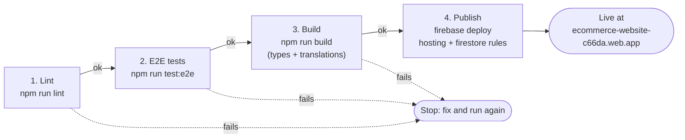

# 09 – Operations and deployment

## Running on a new computer

You need **Node.js** (version 20.19 or newer, from [nodejs.org](https://nodejs.org)) and **Git**.

```bash
git clone https://github.com/MafteiMugurel/ecommerce-website.git
cd ecommerce-website
npm install          # installs the libraries (once)
npm run dev          # starts the site at http://localhost:5173
```

> **Windows / PowerShell:** if you see *“running scripts is disabled on this system”*, use `npm.cmd` instead of `npm`, or run once:
> `Set-ExecutionPolicy -Scope CurrentUser -ExecutionPolicy RemoteSigned`

## All commands

| Command | What it does |
|---|---|
| `npm run dev` | starts the site locally, reloading on every save |
| `npm run build` | checks the code and creates the final version in `dist/` |
| `npm run preview` | serves the `dist/` version locally |
| `npm run lint` | code quality checks |
| `npm run check` | lint + build – a quick “is everything OK?” without publishing |
| `npm run test:e2e` | runs the automated tests (see [08 – Testing](08-testing.md)) |
| `npm run release` | **the full deployment flow**: lint → e2e tests → build → publish site + rules (stops at the first failure) |
| `npm run deploy` | build + publish the site only (Firebase Hosting) |
| `npm run deploy:rules` | publish the Firestore rules only |
| `npm run deploy:all` | build + publish site and rules, without tests |
| `npm run seed` | imports the catalog (categories, products, reviews) from `scripts/data/db.json` |
| `npm run create-user -- <email> <password> "<name>"` | creates an account + profile |
| `npm run update-images -- <admin-email> <admin-password>` | updates only the product photos in Firestore |
| `npm run seed-demo -- <admin-email> <admin-password> <customers-password>` | creates fictitious customers and demo orders |

## Deployment flow

The recommended way to publish is **one command**:

```bash
npm run release
```

It runs every check in order and **stops at the first failure**, so a broken version never reaches the live site:



| Step | What it checks | If it fails |
|---|---|---|
| 1. Lint | code quality (oxlint) | read the message – it names the file and line |
| 2. E2E tests | the site still works like a user expects (catalog, cart, checkout, language…) | open the report with `npm run test:e2e:report` (screenshots included) |
| 3. Build | TypeScript types and that every text exists in both languages | the message names the file and the missing key/field |
| 4. Publish | uploads `dist/` to Hosting and publishes `firestore.rules` | usually not signed in: run `firebase login` |

### Which command when

| Situation | Command |
|---|---|
| normal release of new code | `npm run release` |
| only a text/style change, in a hurry (tests skipped) | `npm run deploy` |
| only the security rules changed | `npm run deploy:rules` |
| site + rules, tests skipped | `npm run deploy:all` |
| check before committing, without publishing | `npm run check` |

### Typical release, step by step
1. Make the change and check it locally with `npm run dev`.
2. `npm run release`.
3. Open https://ecommerce-website-c66da.web.app and check the change (a hard refresh – Ctrl+F5 – if the old version still shows).
4. Save the change on GitHub (`git add`, `git commit`, `git push`).

> Data changes (products, stock, admins) do **not** need a deploy – they are made in the admin panel or the Firebase console and are live immediately.

## Deploying – setup

Once per computer:
```bash
npm install -g firebase-tools   # the Firebase CLI
firebase login                  # sign in with the Google account that owns the project
```
Then, every time:
```bash
npm run deploy
```
The site is live at **https://ecommerce-website-c66da.web.app** within seconds.

**What `firebase.json` does:**
- publishes the `dist/` folder;
- sends every address to the app, so direct links (`/produs/p001`) work on refresh;
- JS/CSS files are cached for a year (their names change with every build) and `index.html` is never cached, so a new deploy shows up immediately.

## Setting up a Firebase project from scratch

1. [console.firebase.google.com](https://console.firebase.google.com) → **Add project**.
2. **Project settings → Your apps → Web (`</>`)** → copy the values into `.env` (`VITE_FIREBASE_…`).
3. **Authentication → Sign-in method** → enable **Email/Password** and **Google**.
4. **Firestore Database → Create database** (production mode).
5. **Import the catalog:** temporarily publish `firestore.seed.rules` → `npm run seed` → immediately publish `firestore.rules`.
6. **Admin:** create an account in the app, then the `admins/{UID}` document (see [How to change things](07-how-to-change-things.md#make-someone-an-administrator)).
7. **Photos:** `npm run update-images -- <admin-email> <admin-password>`.
8. **Optional demo data:** `npm run seed-demo -- <admin-email> <admin-password> <customers-password>`.
9. `.firebaserc` → change the project ID → `npm run deploy`.

## Demo data (`seed-demo`)

Creates, so the statistics look realistic:
- **30 fictitious customers** – real Authentication accounts with `firstname.lastname@example.com` emails (`example.com` is reserved for examples and belongs to nobody), the password given at runtime, addresses in different counties and a few favorites each;
- **200+ orders** over the last 90 days – ~75% from customers with an account, the rest from guests; varied payment methods (card ~40%, cash on delivery ~30%, card on delivery ~20%, bank transfer ~10%); status by age (recent ones “placed/processing”, older ones “delivered”, ~5% cancelled).

Running it again creates no duplicates (accounts are reused, orders have fixed IDs `demo-0001…`).
**Removing demo data:** in the console, the `demo-…` documents in `orders`; the `@example.com` accounts in Authentication and their profiles in `users`.

## Troubleshooting

| Problem | Cause / fix |
|---|---|
| *“running scripts is disabled”* in PowerShell | use `npm.cmd` (see above) |
| *“Missing or insufficient permissions”* / `permission-denied` | the rules do not allow the operation: right account? Is it an admin? Are the rules from `firestore.rules` published? |
| “Admin panel” does not appear | the `admins/{UID}` document is missing or its ID is not exactly the UID of the account you signed in with; sign out and back in |
| Google sign-in shows *“unauthorized-domain”* | add the domain under Authentication → Settings → Authorized domains |
| The published site shows 404 on refresh | the rewrite rule in `firebase.json` is missing (it is included) – run `npm run deploy` again |
| `npm run build` fails about a translation key | the key is missing from `en.ts` or `ro.ts` – add it to both |
| A product photo does not show | the source site is not responding; the app automatically shows the category illustration. Change the URL in the admin panel |
