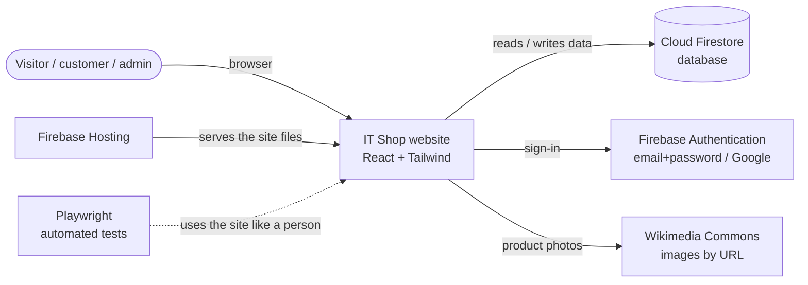

# IT Shop – Knowledge base

This folder explains **the whole project**: what it does, what it is built with, how data flows and how to change things.
It is written for everyone: **you do not need to know how to code** to follow it. Technical terms are explained the first time they appear and collected in the [glossary](01-overview.md#glossary).

> Live site: **https://ecommerce-website-c66da.web.app**
> Source code: **https://github.com/MafteiMugurel/ecommerce-website**

## Where to start

| If you want to… | Read |
|---|---|
| understand what the project is, in short | [01 – Overview](01-overview.md) |
| understand the technologies (React, Firebase, Firestore, Playwright…) | [02 – Technologies](02-technologies.md) |
| understand how the app is organised (folders, layers) | [03 – Architecture](03-architecture.md) |
| see the database structure (every collection and field) | [04 – Database](04-database.md) |
| understand accounts: email/password, Google, admin | [05 – Authentication and roles](05-authentication-and-roles.md) |
| know who may read/write which data | [06 – Security](06-security.md) |
| follow a feature step by step | [Feature flows](features/README.md) |
| **change something** (texts, prices, colours, products, admins…) | [07 – How to change things](07-how-to-change-things.md) |
| run the automated tests (Playwright) | [08 – Testing](08-testing.md) |
| run, deploy or seed the app with data | [09 – Operations and deployment](09-operations-and-deployment.md) |
| know why things were built this way and what the limits are | [10 – Decisions and limitations](10-decisions-and-limitations.md) |

## The project at a glance

## Conventions in these documents

- File paths are relative to the project root, e.g. `src/pages/ProductPage.tsx`.
- Terminal commands are shown in grey blocks. On Windows/PowerShell use `npm.cmd` instead of `npm` if you see *“running scripts is disabled”*.
- The UI is bilingual (Romanian by default, English via the header switcher). Button labels are quoted in English with the Romanian label in brackets where it helps, e.g. “Add to cart” (*Adaugă în coș*).
- URL paths are in Romanian (the store’s primary market), e.g. `/produs/p001` = product page.
- Diagrams are written in [Mermaid](https://mermaid.js.org) and render as pictures on GitHub.
