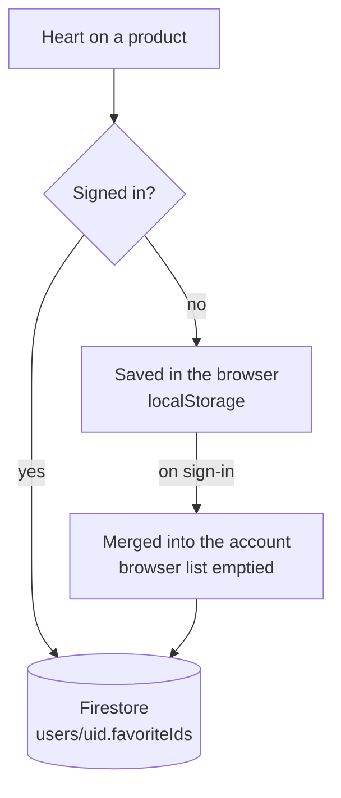

# Account, favorites and orders

## Account
- **Sign in** (`/autentificare`) and **Create account** (`/cont-nou`): email + password, or “Continue with Google”. Details in [05 – Authentication and roles](../05-authentication-and-roles.md).
- After signing in the user returns to the page they came from (e.g. a product page or “My orders”).
- The header shows a circle with the user’s initial; clicking it opens: name, email, **Admin panel** (admins only), **My orders**, **My favorites**, **Sign out**.

## Favorites

- The heart on a card or product page adds/removes a favorite; the header heart shows the count and opens `/favorite`.
- Guests: favorites live in the browser. Signed-in users: in their profile in Firestore, so they follow them on any device.
- On sign-in, favorites saved as a guest are **moved into the account**.
- The change shows immediately; if saving to the database fails, it is reverted.

## My orders (`/comenzile-mele`)
- Signed-in users only (otherwise redirected to sign-in).
- List of the user’s orders, newest first: number, date, status, number of items, total.
- Clicking an order shows the delivery address, payment method and the items (each linking to its product page).
- Data: `orders` filtered by `userId` = the current user (the rules only allow this query).

## Files
`src/pages/LoginPage.tsx`, `RegisterPage.tsx`, `FavoritesPage.tsx`, `OrdersPage.tsx` · `src/components/UserMenu.tsx`, `GoogleSignInButton.tsx`, `RequireAuth.tsx`, `OrderStatusBadge.tsx` · `src/context/AuthProvider.tsx`, `FavoritesProvider.tsx` · `src/services/authService.ts`, `favoritesService.ts`, `orderService.ts`
