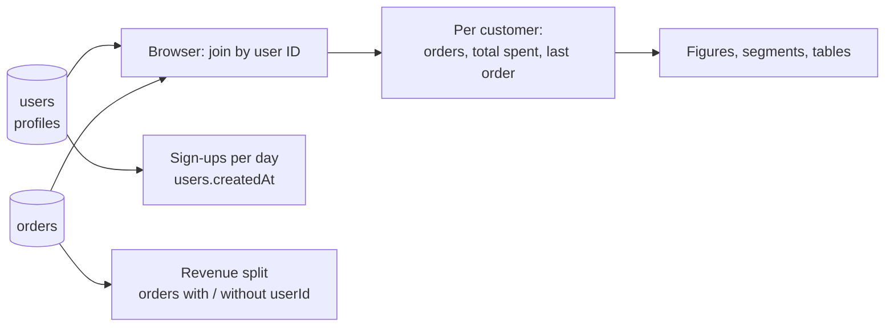

# Admin customer statistics (`/admin/clienti`)

Admins only – the **Customers** tab of the admin panel (tabs: Dashboard | Orders | Customers | Products).

## What it shows

**Period filter:** 7 / 30 / 90 days – applies to “new”, “active”, the sign-ups chart and the revenue split. The other figures cover all time.

**Key figures**

| Figure | Meaning |
|---|---|
| Registered customers | number of accounts (profiles in `users`), plus how many were created in the period |
| Active customers | accounts that placed at least one order in the period |
| Returning customers | accounts with at least 2 (non-cancelled) orders, all time |
| Conversion rate | share of accounts that have ever ordered |
| Average value / customer | total spent ÷ number of customers who ordered |
| Orders / customer | average number of orders among customers who ordered |

**Charts** (each with the Chart / Table switch)
- **New accounts per day** – column chart over the selected period.
- **Revenue: registered customers vs guests** – donut chart of the period’s revenue (cancelled orders excluded).
- **Customers by number of orders** – donut chart: one order, 2–3 orders, 4+ orders, and “No orders” (in neutral gray).

**Tables**
- **Top customers** – the 10 customers who spent the most: name, email (click to write), registration date, orders, total spent, last order.
- **All customers** – the same columns for every account, sorted by total spent, with a search by name or email.

## How it is calculated

- An order belongs to a customer when its `userId` equals the customer’s account ID. Guest orders (`userId = null`) only count in the revenue split.
- Cancelled orders are excluded from counts and sums.
- “Registered” uses the profile’s `createdAt`. Accounts created before profiles existed may have no date and are not counted as new.
- Only admins can read every profile and order – enforced by the Firestore rules.
- Admin accounts also have a profile, so they appear in the list (usually with no orders).

## Files
`src/pages/AdminCustomersPage.tsx` · `src/services/adminService.ts` (`getCustomers`) · `src/services/orderService.ts` (`getAllOrders`) · `src/components/admin/DonutChart.tsx`, `ColumnChart.tsx`, `ChartCard.tsx`, `StatTile.tsx`, `AdminNav.tsx`
