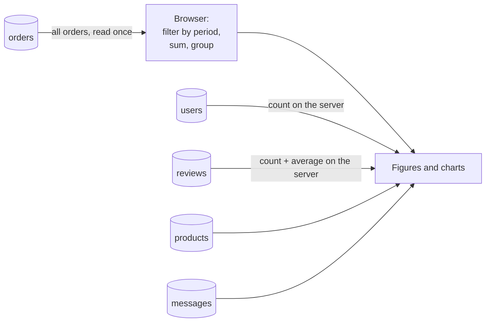

# Admin dashboard (`/admin`)

Admins only. Reached from the account menu or the ☰ menu (**Admin panel**). Tabs at the top: **Dashboard | Orders | Customers | Products** (customer statistics: [Admin customer statistics](admin-customers.md)).

## What it shows

- **Period filter:** 7 / 30 / 90 days – applies to all sales figures and charts.
- **8 key figures:**
  - Revenue (excluding cancelled orders)
  - Orders (and the share from registered customers)
  - Average order value
  - Units sold
  - Registered users (total)
  - Reviews (total) and average rating
  - Products in catalog and how many are out of stock
  - Contact messages
- **Revenue per day** – column chart; hover (or keyboard focus) shows the exact day and amount.
- **Revenue by category** – horizontal bars, largest first.
- **Orders by county** – **donut (pie) chart**: the top 5 counties plus “Other counties”; the table view lists every county.
- **Payment methods** – **donut (pie) chart**: share of orders per payment method.
- Donut charts show the total in the centre (hovering a slice or its legend row shows that slice’s share) and a legend with label, count and percentage for every slice, so colour is never the only cue.
- Each chart has a **Chart / Table** switch showing the same data as a table.
- **Best-selling products** (top 5 by units), **Orders by status**.
- **Recent orders** (10): customer name and city, account or guest, total, and a **status dropdown** to move the order along (Placed → Processing → Shipped → Delivered / Cancelled). The order number opens the [order details](admin-orders.md); “View all orders →” opens the full list.
- **Low stock** (≤ 5 units) with links to the products, and the **latest contact messages**.

## Where the numbers come from

- Sales figures are calculated **in the browser** from the `orders` collection (fine for hundreds of orders).
- User and review counts are calculated **by Firestore itself** (`count`, `average`) without downloading the documents.
- Only admins may read all orders, users and messages – enforced by the rules.

## Chart design
Charts are built without an external library. Bar charts use one colour (`--color-series-1`: `#2a78d6` light / `#3987e5` dark), so the title names the series and no legend is needed. Donut charts use a fixed categorical palette (`--color-series-1…5`, plus a neutral gray for “Other”), validated with a colour-blindness checker for both themes; the order is fixed and never cycled. All colours live in `src/index.css`.

## Files
`src/pages/AdminPage.tsx` · `src/components/admin/AdminNav.tsx`, `StatTile.tsx`, `ChartCard.tsx`, `ColumnChart.tsx`, `BarList.tsx`, `DonutChart.tsx` · `src/services/adminService.ts`, `orderService.ts`
