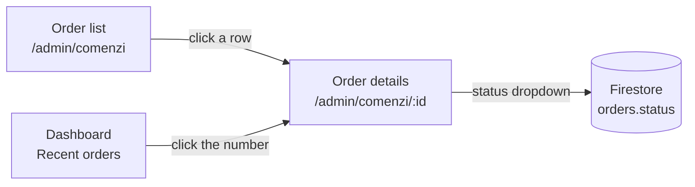

# Admin orders (`/admin/comenzi`)

Admins only – the **Orders** tab of the admin panel (tabs: Dashboard | Orders | Customers | Products).

## Order list
- Every order, newest first: number, date and time, customer (name, city, county, account or guest), payment method, items, total, status.
- **Filters:** text search (order number, customer name, city, county or email) and status, plus an “N of M orders” counter.
- **Click anywhere on a row** (or on the order number) to open its details.
- The dashboard’s **Recent orders** table also links each order number to its details, and has a “View all orders →” link.

## Order details (`/admin/comenzi/:id`)

The page shows:
- **header:** order number, current status badge, date and time placed, and the **status dropdown** (changes are saved immediately; “✓ Status updated” confirms, and the change is reverted with an error message if saving fails);
- **Customer:** name, registered customer or guest, account ID (for registered customers), clickable email and phone;
- **Delivery address:** name, address, city, county (older orders created before the checkout step show a note instead);
- **Payment:** method, its explanation and the total;
- **Ordered products:** photo, name (links to the product page), code, unit price, quantity, subtotal; total units and total price;
- the full Firestore document ID, for looking the order up in the console.

## Data and permissions
Reads a single document from `orders` (`getOrder`) and updates only its `status` (`updateOrderStatus`). The Firestore rules allow reading any order and changing it only for admins.

## Files
`src/pages/AdminOrdersPage.tsx`, `AdminOrderDetailPage.tsx`, `AdminPage.tsx` (recent orders links) · `src/components/admin/AdminNav.tsx` · `src/components/OrderStatusBadge.tsx` · `src/services/orderService.ts` · `src/utils/format.ts` (`shortOrderId`)
