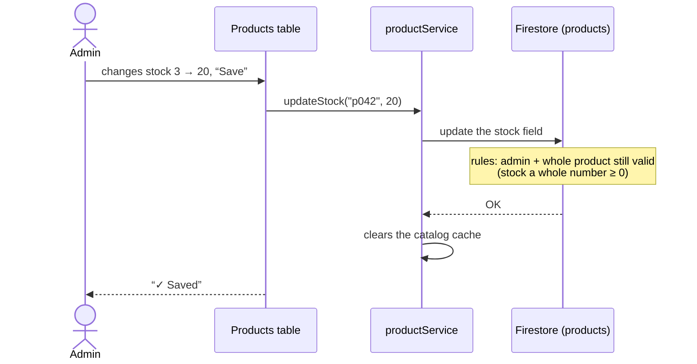

# Admin product management (`/admin/produse`)

Admins only – the **Products** tab of the admin panel.

## Product list and inline stock editing
- Table of all products: photo, name, code and brand, category, price, **stock**, actions (*View in store*, *Edit*).
- **Filters** in one row: text search (name, brand or code), category, “Low stock only (≤ 5)”, plus a “N of M products” counter.
- **Stock editing on the row:** −/+ buttons or type a number → **Save** appears → click it or press Enter. Low stock is shown in amber and zero in red. “✓ Saved” confirms; an error message appears if saving fails.

## Add / edit form (`/admin/produse/nou`, `/admin/produse/:id`)
Sections:
1. **General information** – name, brand, category, price (RON), stock (units), description.
2. **Image** – image URL with a **live preview**; when a URL is set, attribution fields appear (author, licence, source page, licence URL, source site) and the “Illustrative image” tick box. Empty URL = the category illustration.
3. **Technical specifications** – rows of name/value; add or remove rows.

Validation (same limits as the Firestore rules): name, brand, category and description required; price > 0; stock a whole number ≥ 0; image URL starting with `https://` or `/`; each specification needs both a name and a value.

- New products get the next free code (`p101`, `p102`…), rating 0 and today’s date.
- After saving you return to the list; the catalog cache is cleared so the store shows the change.

## Files
`src/pages/AdminProductsPage.tsx`, `AdminProductFormPage.tsx` · `src/components/admin/AdminNav.tsx` · `src/services/productService.ts` (`saveProduct`, `updateStock`, `nextProductId`) · `firestore.rules` (`validProduct`)
