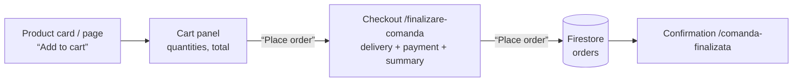
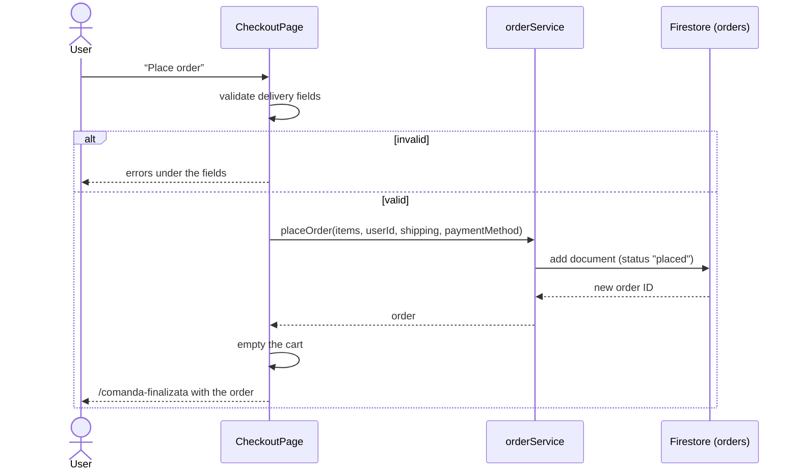

# Cart and checkout

## Steps

### 1. Cart
- Opens from the cart icon (top-right) or automatically after “Add to cart” on a product page.
- Change quantities with −/+ (never above stock), remove items, empty the cart, see the total.
- Kept in the browser (`localStorage`), so it **survives a refresh**. It is not linked to the account.

### 2. Checkout – delivery and payment (`/finalizare-comanda`)
A step indicator shows **Cart ✓ → Delivery & payment → Confirmation**.

**Delivery details** (all required; for signed-in users, name and email are pre-filled):

| Field | Validation |
|---|---|
| Full name | at least 3 characters |
| Phone | Romanian number, e.g. `0722 123 456` or `+40…` |
| Email | valid email address |
| County | chosen from the list of 42 (`src/data/romania.ts`) |
| City / town | at least 2 characters |
| Address | at least 5 characters |

Errors appear under each field after the first submit attempt and disappear as soon as the field is corrected.

**Payment method** (one selector):

| Option | Stored as | Note |
|---|---|---|
| Online card payment | `card` | **simulated** – no real payment is processed |
| Card on delivery | `card_on_delivery` | pay the courier by card |
| Cash on delivery | `cash_on_delivery` | pay the courier in cash |
| Bank transfer | `bank_transfer` | shipped after payment is confirmed |

**Summary:** items, quantities, subtotal, free delivery, total.

### 3. Placing the order

The Firestore rules accept a new order only with status `placed`, a complete address and a known payment method (see [06 – Security](../06-security.md)).

### 4. Confirmation (`/comanda-finalizata`)
“Congratulations on your order!”, order number, delivery address, payment method, items and total. Opening this address without a fresh order redirects to the home page.

## What is saved
A document in `orders` – fields described in [04 – Database](../04-database.md#orders). Items are stored as **snapshots** (name, price, image at the time of the order).

## Files
`src/components/CartDrawer.tsx` · `src/context/CartProvider.tsx`, `cartContext.ts` · `src/pages/CheckoutPage.tsx`, `OrderSuccessPage.tsx` · `src/components/OrderShippingSummary.tsx` · `src/services/orderService.ts` · `src/types/order.ts` · `src/data/romania.ts`
