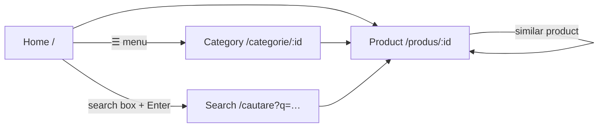

# Catalog and search

## What the user sees
- **All products** (`/`): a grid of product cards – photo, category, brand, name, price, rating, “Add to cart” button and a heart for favorites.
- **Category menu** (☰ button, top-left): a panel sliding in from the left with “All products”, the 8 categories, then Favorites and Contact (and “Admin panel” for admins).
- **Category page** (`/categorie/servere`): only that category’s products.
- **Search** (box in the header; under the header on phones): Enter → `/cautare?q=…`.
- **Product page** (`/produs/p001`): photo (+ attribution), price, stock status, quantity, add to cart / favorites, quick specs, then **Product details** (description + full specifications table), **Similar products** and **Reviews**.

## Flow

## How search works
1. The query and every product’s **name, brand, category and description** are normalised: lower case, **diacritics removed** (“Căști” → “casti”).
2. The query is split into words; a product matches only if it contains **all** words.
3. It runs in the browser on the already-loaded catalog – instant, no extra database reads.

## How “similar products” are chosen
Same category, excluding the current product, sorted by **closest price**, first 4.

## Stock status on the product page
| Stock | Shown |
|---|---|
| 0 | “Out of stock”, button disabled |
| 1–5 | “Limited stock – only N left” |
| > 5 | “In stock” |
You can never add more units than are in stock (counting what is already in the cart).

## Data
Reads `products` and `categories` once per visit (cached in memory) and `reviews` for the open product.

## Files
`src/pages/ProductsPage.tsx`, `SearchPage.tsx`, `ProductPage.tsx` · `src/components/ProductCard.tsx`, `ProductGrid.tsx`, `ProductSpecs.tsx`, `NavMenu.tsx`, `MenuDrawer.tsx`, `SearchBar.tsx` · `src/utils/search.ts` · `src/services/productService.ts`, `categoryService.ts` · `src/hooks/useProducts.ts`, `useCategories.ts`
