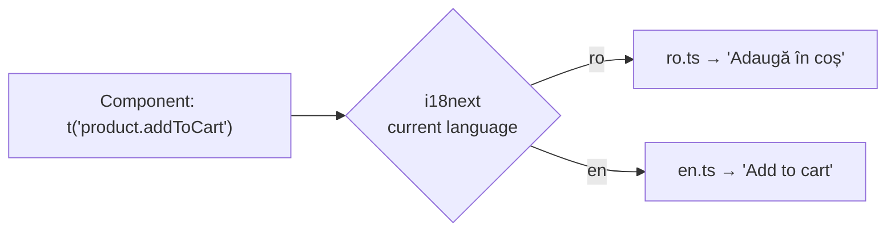

# Language and theme

## Language (Romanian / English)
- Switcher in the header (globe icon, **RO / EN**). Saved in the browser.
- First visit: the browser language if it is Romanian or English, otherwise Romanian.
- Everything in the interface is translated: buttons, menus, messages, sign-in errors, category names, order statuses, payment methods, dashboard.
- **Formatting follows the language:** prices (`1.899,00 RON` vs `RON 1,899.00`), dates and numbers.
- **Plurals follow each language’s grammar:** Romanian “1 produs / 2 produse / 20 de produse”, English “1 product / 2 products”.
- Database content (descriptions, specifications, reviews) is shown as stored (Romanian).

### How it works

- `src/i18n/locales/ro.ts` – Romanian texts (the reference); `en.ts` – English, **with exactly the same keys**, checked by TypeScript: a missing key fails the build.
- Category names stored in Romanian in the database are translated by their ID (`src/i18n/useCategoryLabel.ts`).
- The `<html lang>` attribute is updated, which helps screen readers and the browser’s own translation.

## Theme (light / dark)
- Moon / sun button in the header. Saved in the browser; without a saved choice the operating-system setting is used.
- A tiny script in `index.html` applies the theme **before** the page appears, avoiding a white flash in dark mode.
- **How the colours work:** in `src/index.css`, the `.dark` class **inverts the gray scale** (dark text becomes light, light backgrounds become dark) and switches the `surface` colour used for cards and panels. Accent colours (red, green, indigo, amber) have explicit dark variants in the components.
- Rule for new components: card backgrounds use `bg-surface`, not `bg-white`.

## Files
`src/i18n/index.ts`, `locales/ro.ts`, `locales/en.ts`, `i18next.d.ts`, `useCategoryLabel.ts` · `src/components/LanguageSwitcher.tsx`, `ThemeToggle.tsx` · `src/context/ThemeProvider.tsx` · `src/utils/format.ts` · `src/index.css` · `index.html`
