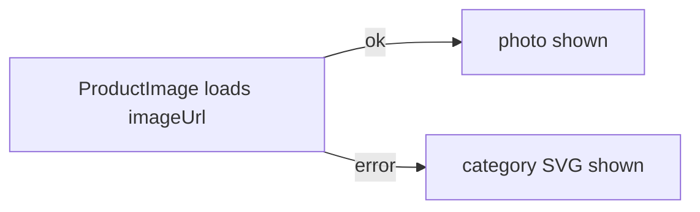

# Product images

## Approach: images by URL
Product photos are **not uploaded** anywhere – each product stores the **address (URL)** of a photo hosted elsewhere, in `imageUrl`. This avoids paying for file storage (Firebase Storage).

## Where the photos come from
All 100 photos come from **[Wikimedia Commons](https://commons.wikimedia.org)**, chosen because:
- the images have **free licences** (CC0, CC BY, CC BY-SA, public domain…);
- showing them on other sites (“hotlinking”) is allowed and the URLs are stable;
- shop and manufacturer images are copyrighted, often block use from other domains and change address.

Every photo was checked:
- **31 products** show the **exact model** (or the same model in another capacity);
- **69 products** show a **representative** photo (same product family, or the same type of product). These are marked `representative: true` and the product page says “Image for illustration purposes – the delivered product may look different”.

## Attribution
Creative Commons licences require crediting the author and licence. Each photo stores `imageCredit` (author, licence, licence link, source page, source site), shown under the photo on the product page as: *Photo: Author, Licence, via Wikimedia Commons* – with links.

## Fallback
If an external image fails to load (site down, image removed), the app automatically shows the **category illustration** (`public/images/categories/*.svg`) instead of a broken image.

## Changing a photo
- One product: admin panel → **Products** → **Edit** → *Image URL* + attribution (see [How to change things](../07-how-to-change-things.md#-change-a-product-photo)).
- All products from `scripts/data/db.json`: `npm run update-images -- <admin-email> <admin-password>` (updates only the photo fields).

## Files
`src/components/ProductImage.tsx` · `src/utils/productImage.ts` · `src/pages/ProductPage.tsx` (attribution) · `scripts/update-images.mjs` · `public/images/`
