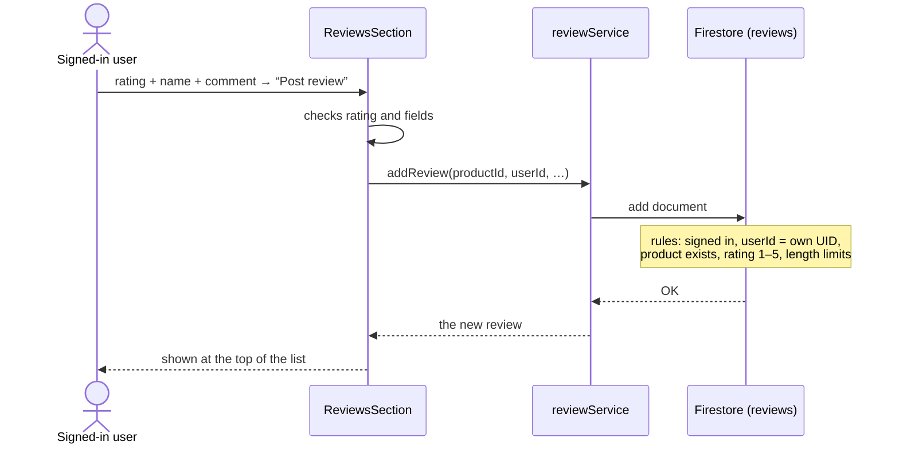

# Reviews

## Reading
At the bottom of every product page:
- **summary**: average rating, number of reviews and how many reviews each star level (5 → 1) has;
- **list** of reviews, newest first: author, date, stars, comment.

## Writing
- **Signed-in users only.** Guests see “You need to be signed in to leave a review” and a button to sign in (they come back to the reviews afterwards).
- Form: star rating (1–5, required), name (pre-filled with the account name), comment (up to 1000 characters).
- The review appears at the top of the list immediately after posting.

Reviews cannot be edited; admins can delete them from the Firebase console.

## Note on ratings
The rating on the product card comes from the product’s `rating` field; the review section computes the average from the actual reviews, so the two may differ slightly.

## Files
`src/components/ReviewsSection.tsx`, `StarRating.tsx` · `src/services/reviewService.ts` · `src/types/review.ts`
